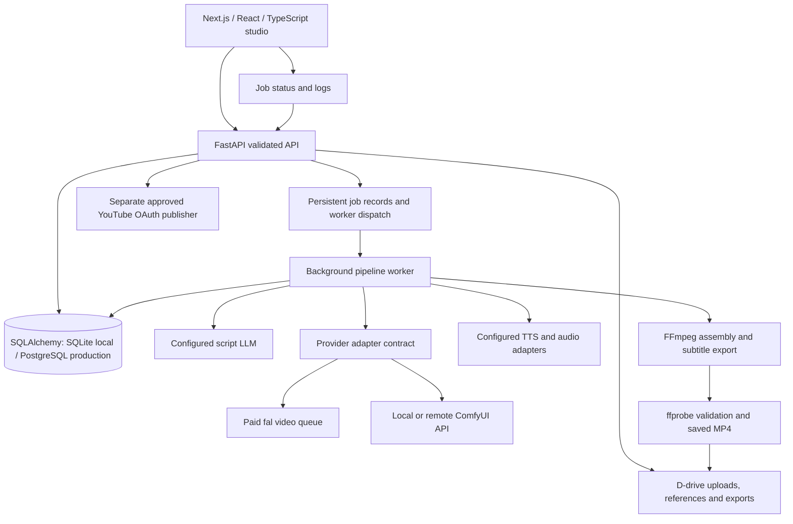

# Models, hardware, architecture and staged implementation plan

Prepared 29 October 2026 from the supplied requirements, reference audit and official provider/model documentation. This document is a design and acceptance plan; it does not certify that a phase or real inference run has completed. See the application's current README for implemented behavior.

## Recommended inference options

| Option | Intended role | Hardware / service facts | Decision |
|---|---|---|---|
| Wan 2.2 A14B through fal | Initial hosted text-to-video and image-to-video adapter | A paid hosted API with asynchronous queue operations; key and funded account required | Best first acceptance route on typical local hardware; keep credentials on the backend |
| Wan 2.2 TI2V-5B through ComfyUI | Configurable local text/image generation | Official Wan command lists at least 24 GB VRAM with offload, dtype conversion and text encoder on CPU; nominal 720p is 704×1280 or 1280×704 | Suitable future local backend on larger hardware, with the exact workflow verified first |
| Wan 2.1 T2V-1.3B | Lower-memory local research option | Official reference reports 8.19 GB VRAM for its 1.3B path, which exceeds many consumer GPUs | Verify the selected model and workflow against the available hardware |
| HunyuanVideo (original repository) | Alternative large-model adapter | Official 720×1280×129-frame configuration reports 60 GB peak VRAM and Linux testing; custom model terms | Remote GPU option, not the initial Windows laptop route |
| LTX-Video / current LTX family | Alternative for conditioned generation and faster iteration | Checkpoint-specific capabilities and model licenses; original repository now points to LTX-2 for continued development | Evaluate a pinned model/workflow separately; do not inherit every family's advertised feature |

Sources: [fal text-to-video schema](https://fal.ai/models/fal-ai/wan/v2.2-a14b/text-to-video/api), [fal image-to-video schema](https://fal.ai/models/fal-ai/wan/v2.2-a14b/image-to-video/api), [Wan 2.2 repository](https://github.com/Wan-Video/Wan2.2), [Wan 2.1 repository](https://github.com/Wan-Video/Wan2.1), [HunyuanVideo requirements](https://github.com/Tencent-Hunyuan/HunyuanVideo#-requirements), [LTX-Video repository](https://github.com/Lightricks/LTX-Video), [LTX model card](https://huggingface.co/Lightricks/LTX-Video), [official ComfyUI Wan workflows](https://docs.comfy.org/tutorials/video/wan/wan2_2).

The fal Wan endpoint documents 17–161 generated frames, 480p/580p/720p, and landscape/portrait/square controls. Use its actual frame and FPS settings to determine duration; longer stories require multiple clips. Avoid exposing native 1080p or arbitrary durations merely because a UI mockup lists them. Queue state does not imply a known percentage of model inference. Record unknown cost as unknown; an actual billed cost must come from provider usage records. Current charges must be checked in the provider account before use.

Wan 2.2 models are published under Apache 2.0. LTX code and model weights need separate checks: the repository code license does not imply identical terms for every checkpoint. Preserve model/asset notices and verify the exact selected checkpoint before redistribution. No downloaded model weights or cloud account access are implied by these recommendations.

## Hardware finding

Hardware diagnostics establish device presence, not an installed and working PyTorch/CUDA inference environment. Model memory requirements vary by checkpoint, precision, quantization and workflow. Verify the selected workflow on the target hardware; community quantization or aggressive offload may enable smaller configurations, but results and performance must be tested rather than assumed.

The web server, database, project management and FFmpeg processing can run without a video-inference GPU. A hosted inference adapter is the recommended first route. Local configuration must check available VRAM, installed model files, custom nodes, workflow schema and actual test inference. Run one local GPU job at a time initially; catch OOM explicitly and release resources via the chosen inference engine rather than assuming Python web-process garbage collection manages GPU memory.

Keep model weights, runtimes, caches, uploads and exports under the configured project storage locations. Disk checks must use the destination volume. Hardware diagnostics should report CPU, RAM and free storage from the live process; unsupported readings should remain unknown rather than invented.

## Target architecture



For initial local operation, a database-backed worker can avoid requiring Redis on Windows while keeping jobs outside web requests. The worker needs transactional claiming, cancellation checkpoints, persisted provider IDs and crash recovery. For production workers, use PostgreSQL and a supported queue such as Redis/Celery (on a supported host), preserving the same provider contract. Never retry a timed-out submission blindly: a paid remote job may already exist. Resume its recorded request where possible, or report ambiguous submission for review.

Provider capabilities are data, not assumptions: text/image modes, sizes, ratios, frame limits, conditioning and cancellation vary per adapter. Store a scene's source prompt, selected character IDs, provider/model configuration, request ID, output path and validated media metadata. Validate downloads before marking complete. Preserve successful scene artifacts so an individual failed scene can be retried without paying for every previous scene again.

## Proposed project structure

```text
project-root\
  frontend\                 Next.js studio, client state and API client
  backend\                  FastAPI, models, schemas, adapters, pipeline and tests
  scripts\                  Windows setup/start/diagnostics helpers
  docs\                     Evidence, architecture, setup and verification reports
  references\youtube-skills\  Audited source plus original MIT notice
  workflows\                User-configured ComfyUI API workflows
  data\                     Persistent DB, uploads, scene outputs and exports
  .tools\                   Portable runtimes and FFmpeg
  .cache\                   Dependency/model caches
  .tmp\                     Bounded temporary workspace
```

## Phase gates

| Phase | Work to implement | Required acceptance evidence | Status at design time |
|---|---|---|---|
| 1 Foundation | UI, validated API, DB, uploads, settings, projects and characters | Create/edit/reopen project across restart; reject bad inputs; frontend production build | Pending implementation verification |
| 2 Real generation | Hosted adapter and configurable ComfyUI adapter, worker, polling/cancel/retry, MP4 validation | A new prompt creates an actual provider job and a decodable downloaded MP4 | Blocked until a configured inference provider is available |
| 3 Automated production | LLM scene plan, per-scene video, TTS, subtitles, FFmpeg assembly, resume | Real multi-scene clips assembled with aligned audio and subtitles; intermediate outputs survive interruption | Depends on Phase 2 and configured LLM/TTS |
| 4 Advanced studio | Character references, scene reorder/trim/regeneration, reference analysis | Saved timeline edits affect export; conditioning actually passed; limitations visible | Pending feature tests |
| 5 YouTube | ZIP hooks/metadata tools, OAuth, approved upload and schedule | Tools run on real inputs; account authorization and explicit publishing enablement; test private upload only if authorized | Tools audited; publishing remains unverified/disabled |
| 6 Deployment | Integration tests, failure handling, quotas, security and Windows startup | Local startup and persistence tests; separate public-deployment auth/rate-limit review | Pending final checks |

No substitute footage, reference-video reuse, image slideshow or hardcoded completed output can satisfy Phase 2. Provider contract tests and fixture videos verify plumbing only; identify them as tests. A missing API key or model must produce a configuration state, never fake success. Do not claim the full acceptance workflow is ready until an actual inference and multi-scene run have passed.
